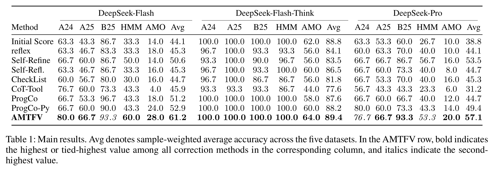

# AMTFV：面向大语言模型自纠错的数学工具流验证

**Agentic Mathematical Tool-Flow Verification for LLM Self-Correction**

AMTFV 用于核验和修正大语言模型给出的数学答案。它通过数学工具流（Mathematical Tool Flow，MTF）将数学推理与工具执行分开。模型在核验过程中提出计算请求，工具箱执行计算，模型根据返回的结果继续核验或修正答案。

## 方法框架

[](assets/framework.png)

给定题目和初始回答，左侧模块负责核验候选答案。需要计算时，中间的 MTF 接口将请求传给右侧工具箱。工具箱选择合适的工具，完成计算并返回结果。左侧模块据此接受答案、修正答案，或调整核验步骤。

## 主要结果

[](assets/main-results.png)

## 安装与环境配置

在仓库根目录执行：

```bash
python -m pip install -r requirements.txt
```

示例调用 DeepSeek 官方 API。请设置 `DEEPSEEK_API_KEY`。PowerShell 使用 `$env:DEEPSEEK_API_KEY = "<your-key>"`，Bash 使用 `export DEEPSEEK_API_KEY="<your-key>"`。

## 快速开始

仓库附带的 `demo` 包含两道数学题。执行下面两步会调用模型。

### 1. 生成公共初答

```bash
python 0-1_initial_response/generate_initial_responses.py --dataset demo --output-dir runs/initial
```

初答保存在本地 `runs/initial/deepseek-flash_demo_first_response.jsonl`，评分保存在同目录的 `demo.initial-eval.json`。比较不同方法时可共用这批初答，在第 2 步用 `--initial-dir` 指向保存初答和版本记录的目录。

### 2. 运行 AMTFV 并评分

```bash
python 0-3_all_model_test/run_plan_S_SC/S_SC_S2-3_Backward/run_amtfv.py --dataset demo --initial-dir runs/initial --run
```

程序读取初答，启动本地 Python 工具并执行核验与纠错。每次运行默认写入 `runs/<UTC时间戳>/`。其中 `model_outputs/demo.json` 保存逐题推理和最终回答，`evaluation.json` 保存统一评分结果。参考答案仅用于评分。Python 工具会在本机执行模型生成的代码，请使用专用、低权限的环境。

要改跑 HMMT，请先按 `0-0_datasets/README.md` 准备题集，再将两步命令中的 `--dataset demo` 换成 `--dataset hmmt_feb_2025`。

部分验证与纠错代码改编自 ProgCo，详见[来源说明](THIRD_PARTY.md)。

## 引用

[arXiv:2607.29549](https://arxiv.org/abs/2607.29549)

```bibtex
@misc{zou2026amtfv,
  title = {{AMTFV}: Agentic Mathematical Tool-Flow Verification for {LLM} Self-Correction},
  author = {Zou, Rui and Zhu, Yutao and Wei, Mengqi and Wen, Ji-Rong},
  year = {2026},
  eprint = {2607.29549},
  archivePrefix = {arXiv},
  primaryClass = {cs.AI},
  url = {https://arxiv.org/abs/2607.29549}
}
```
