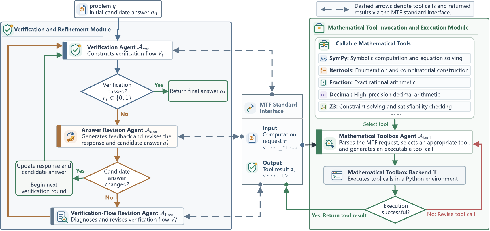

# AMTFV：面向大语言模型自纠错的数学工具流验证

**Agentic Mathematical Tool-Flow Verification for LLM Self-Correction**  
Rui Zou · Yutao Zhu · Mengqi Wei · Ji-Rong Wen

AMTFV 用于核验和修正大语言模型给出的数学答案。它通过数学工具流（Mathematical Tool Flow，MTF）将数学推理与工具执行分开。模型在核验过程中提出计算请求，工具箱执行计算，模型根据返回的结果继续核验或修正答案。

## 方法框架



给定题目和初始回答，左侧模块负责核验候选答案。需要计算时，中间的 MTF 接口将请求传给右侧工具箱。工具箱选择合适的工具，完成计算并返回结果。左侧模块据此接受答案、修正答案，或调整核验步骤。

## 主要结果

下表节选自论文主实验，数值为各方法在 5 个数学题集、共 170 道题上的答案准确率。两个 Flash 设置均使用 `deepseek-v4-flash`，分别关闭和开启思考模式。

| 方法 | DeepSeek-Flash | DeepSeek-Flash-Think | DeepSeek-Pro |
|---|---:|---:|---:|
| 初始回答 | 44.1% | 88.8% | 38.8% |
| ProgCo | 51.2% | 87.6% | 44.7% |
| ProgCo-Py | 52.9% | 88.2% | 49.4% |
| **AMTFV** | **61.2%** | **89.4%** | **57.1%** |

## 安装与环境配置

在仓库根目录执行：

```bash
python -m pip install -r requirements.txt
```

设置 [`DEEPSEEK_API_KEY`](.env.example)。例如在 PowerShell 中使用 `$env:DEEPSEEK_API_KEY = "<your-key>"`，在 Bash 中使用 `export DEEPSEEK_API_KEY="<your-key>"`。初答、核验、纠错和评测均调用 [DeepSeek 官方 API](https://api-docs.deepseek.com/)，请求 `deepseek-flash` 的非思考模式。运行时记录模型标识；上表来自论文的 V4 实验。

## 快速开始

[`demo`](0-0_datasets/hard_test_raw/demo/test_top2_filt2.json) 是一个包含两道题的数据集。与 HMMT 等题集一样，通过 `--dataset` 指定。下列两条命令会调用模型。

### 1. 生成公共初答

```bash
python 0-1_initial_response/generate_initial_responses.py --dataset demo --output-dir runs/initial
```

同一模型的各方法共用这批初答。已有匹配的初答时，可直接运行第 2 步。

### 2. 运行 AMTFV 并评分

```bash
python 0-3_all_model_test/run_plan_S_SC/S_SC_S2-3_Backward/run_amtfv.py --dataset demo --initial-dir runs/initial --run
```

入口读取初答，自动启动 Python 工具服务并执行核验与纠错。每次运行会新建一个目录：`model_outputs/` 保存逐题推理和最终回答，`evaluation.json` 保存统一评测的判定及准确率。参考答案仅供评分使用。Python 工具会在本机执行模型生成的代码，请使用专用、低权限的环境。

要改跑 HMMT，将两条命令中的 `--dataset demo` 换成 `--dataset hmmt_feb_2025` 即可。其他题集的来源和准备方法见[数据说明](0-0_datasets/README.md)。

## 引用

Rui Zou, Yutao Zhu, Mengqi Wei, and Ji-Rong Wen. *AMTFV: Agentic Mathematical Tool-Flow Verification for LLM Self-Correction.*

[第三方代码、数据和许可证](THIRD_PARTY.md)
